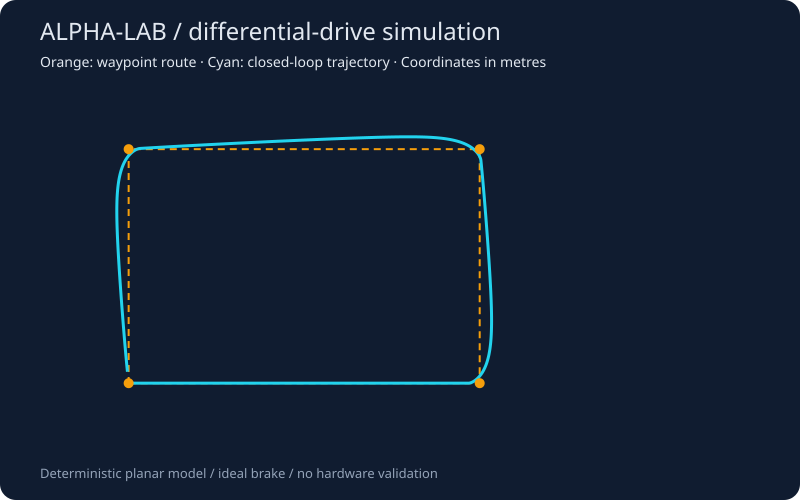

# ALPHA-LAB

**ALPHA机器人控制实验平台 · Differential-drive robotics lab**

[](https://github.com/Jing-2237/ALPHA-LAB/actions/workflows/ci.yml)


面向小型室内移动底盘的可复现工程原型：将航点导航、差速运动学、双轮 PID、指令限幅、安全停机和遥测导出组织成一条完整控制链。核心运行只依赖 Python 标准库。

当前验证范围为二维确定性仿真；URDF 为参考底盘模型。尚未接入实体 ALPHA 硬件、ROS 2、编码器或激光雷达，不代表任何厂商官方 SDK，也不包含实机实验结论。



## Quick start

在仓库根目录执行，Python 3.10+：

```bash
python -m alpha_lab --config config/robot.json --mission config/mission.json
python -m alpha_lab --obstacle-at 2 --output outputs/obstacle
python -m unittest discover -s tests -v
```

每次运行产生 `telemetry.csv`、`summary.json` 和 `trajectory.svg`。直接用浏览器打开 SVG 即可查看轨迹，无需绘图库。可选安装命令：`python -m pip install -e .`，随后可执行 `alpha-sim`。

## Implemented

| 模块 | 行为 |
| --- | --- |
| 航点跟踪 | 航向误差反馈、转弯降速、逐点切换和终点停止 |
| 运动学 | 车体速度转轮速、等比例限幅、圆弧精确积分 |
| 双轮控制 | 前馈 + PID、条件积分抗饱和、控制器复位 |
| 执行器模型 | 一阶轮速响应，默认 50 Hz 控制周期 |
| 安全门 | 指令超时、非法数值、障碍距离与急停输入，故障锁存 |
| 可观测性 | 每周期位姿、指令、轮速、执行器输出与任务状态 |
| 工程验证 | 单元与闭环集成测试、Python 3.10/3.12 CI 配置 |

## Reproduced simulation results

以下结果来自仓库默认参数，原始遥测与完整配置保存在 [examples](examples/) 中，可用上述命令复现。仿真时间不等于程序运行耗时。

| 场景 | 结果 | 仿真时长 | 指标 |
| --- | --- | --- | --- |
| 1.5 m × 1.0 m 四航点路线 | completed | 18.14 s | 4/4 航点，最终位置误差 0.049181 m |
| 第 2 s 注入近距离障碍 | stopped | 2.02 s | 锁存 obstacle，末行双轮速度为零 |

障碍判定发生在周期起点，日志时间戳记录周期终点，因此 `2.0 s` 注入对应 `2.02 s` 末行。停止模型使用理想制动，不模拟真实惯性制动距离。终点误差阈值为 0.05 m；控制器不约束终点朝向，也不具备绕障规划能力。

## Repository

```text
alpha_lab/
  model.py          # 参数、运动学、里程计积分
  control.py        # PID、航点跟踪、安全门
  simulation.py     # 闭环仿真与任务状态
  __main__.py       # CLI、日志与 SVG 导出
config/             # 底盘参数与任务航点
robot/alpha.urdf    # 参考差速底盘几何模型
tests/              # 控制边界与集成测试
examples/           # 可复现的仿真记录
docs/               # 架构、接口与验证说明
.github/workflows/  # 自动测试与仿真工件导出
```

## Engineering notes

- 所有长度单位为 m，时间为 s，角度为 rad，轮速为 rad/s。
- 坐标约定：x 向前、y 向左、z 向上；正角速度逆时针。
- [架构与控制设计](docs/architecture.md) 描述控制链、公式和参数。
- [硬件接入说明](docs/hardware-integration.md) 给出未来适配的接口契约与实施步骤。
- [验证记录](docs/validation.md) 区分已验证行为和待验证内容。

后续方向：编码器/电机驱动适配、真实制动模型、ROS 2 节点封装，以及基于测量数据的参数辨识。
