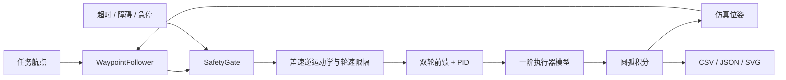

# 架构与控制设计

## 数据流



仿真在每次循环刷新指令时间戳，故超时分支通过独立单元测试验证。仿真位姿直接反馈给导航器，没有模拟定位噪声或定位延迟。

## 差速底盘

设轮半径为 r、轮间距为 b、车体线速度为 v、角速度为 ω：

```text
ω_left  = (v - ω b/2) / r
ω_right = (v + ω b/2) / r
v       = r (ω_right + ω_left) / 2
ω       = r (ω_right - ω_left) / b
```

轮速超限时对左右轮同时按最大超限比例缩放，以保留曲率。位姿使用恒定轮速区间的圆弧精确积分；角速度接近零时使用直线极限，航向归一化到 [-π, π]。

## 导航与轮速控制

导航器计算目标方位与当前航向的误差 e，以 `2.8 × e` 生成角速度并限幅；线速度为距离比例项与最大速度的较小值，再乘以 `max(0, cos(e))`。目标位于后方时先原地转向。距离低于目标容差即进入下一航点。

轮速闭环使用目标轮速前馈及 PID 反馈。执行器输出范围 [-1, 1]；控制输出饱和且误差继续推高饱和程度时暂停积分。执行器模型为一阶滞后，离散增益为 `1 - exp(-dt / τ)`。

| 参数 | 默认值 | 含义 |
| --- | --- | --- |
| wheel_radius | 0.05 m | 轮半径 |
| track_width | 0.30 m | 左右轮中心间距 |
| max_linear_speed | 0.35 m/s | 线速度上限 |
| max_angular_speed | 1.8 rad/s | 角速度上限 |
| max_wheel_speed | 20 rad/s | 电机模型满输出轮速 |
| motor_time_constant | 0.12 s | 一阶响应时间常数 |
| dt | 0.02 s | 仿真控制周期 |
| goal_tolerance | 0.05 m | 航点切换距离 |
| command_timeout | 0.25 s | 指令最大允许年龄 |
| stop_distance | 0.25 m | 障碍停止阈值 |

PID 参数单位与归一化执行器输出相关；默认参数仅适用于当前仿真模型。

## 安全状态与日志

安全门优先检查急停，再检查非法指令、时间戳和障碍距离；首次故障原因锁存，后续正常输入不自动解除。仿真出现锁存故障后将执行器和轮速归零并结束任务。生产系统需要独立的硬件急停、制动逻辑及人工复位流程。

`telemetry.csv` 每行记录周期结束时间、平面位姿、速度指令、实际双轮速度、双轮归一化执行器输出、当前航点下标和安全原因。`summary.json` 包含完整配置、航点、故障注入时刻与任务结果，便于复现。

CLI 退出码：完成或触发场景停机为 0，任务超时为 2；无效参数由 argparse 报错并返回 2。自动化调用应同时检查 JSON 的 `status` 与 `stop_reason`。
